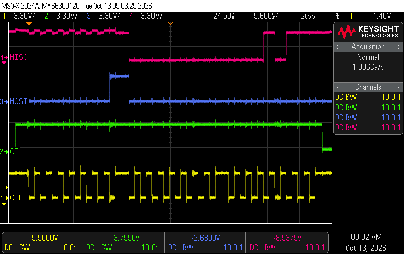
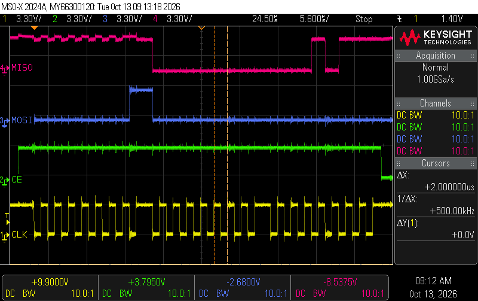
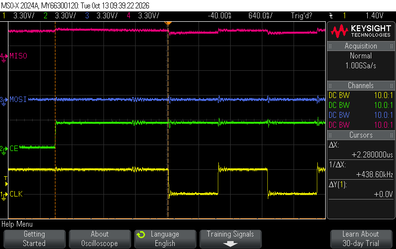
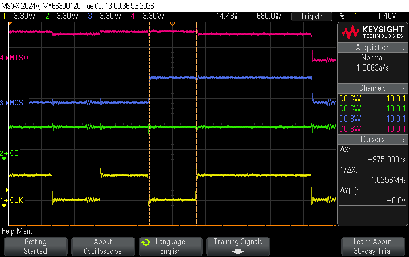
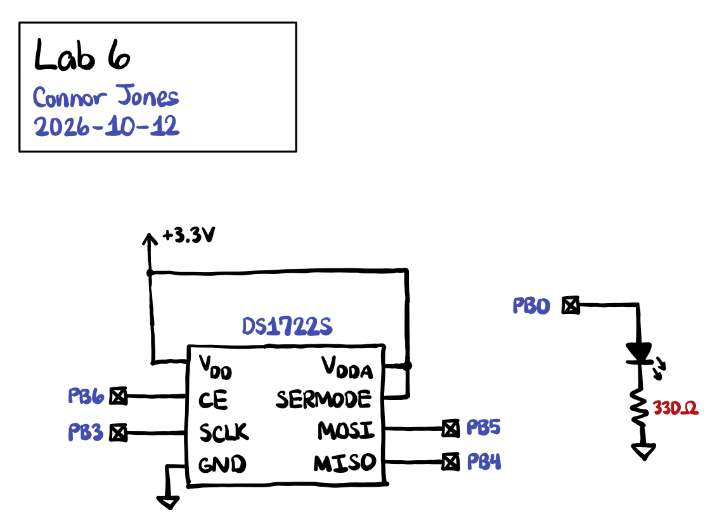
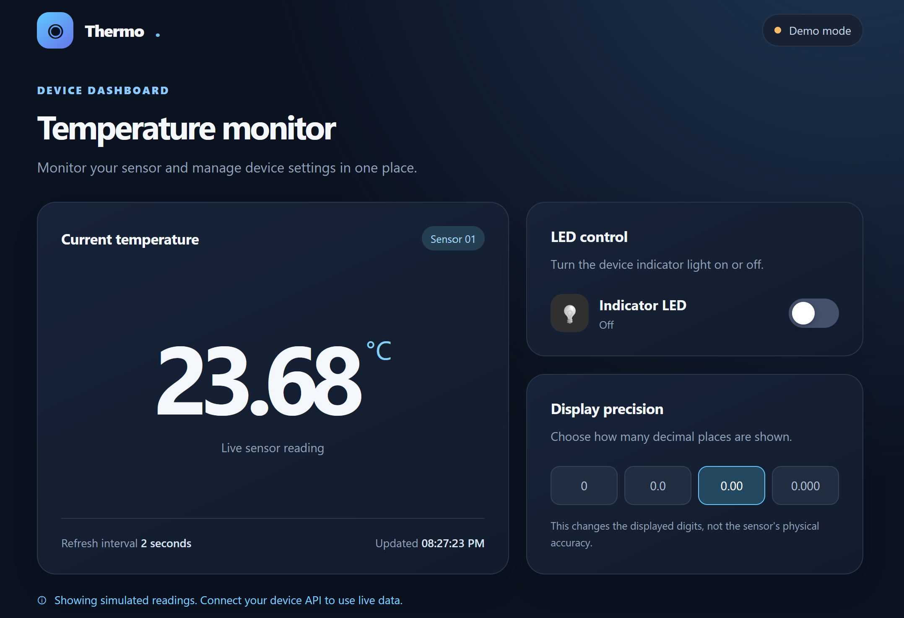

## Introduction

In this lab, I built an internet-accessible device to control the state of an external LED and read measurements from a temperature sensor. To interface with the temperature sensor, I configured the SPI peripheral on the MCU and wrote a basic driver to exchange data with the sensor.

The code used for this lab can be found at [this repository](https://github.com/conjoneshmc/e155-labs), under the `lab-6` folder.

## Scope Trace of SPI Transaction

Both images above show an oscilloscope trace of a complete SPI communication between the MCU and temperature sensor. The operation reads the recorded temperature from the sensor and sends it to the MCU. It consists of three transactions:

1. The first is a write by the MCU specifying the address of the register we are reading from. In this case, `0x01` corresponds to the register storing the lower 8 bytes of the recorded temperature.
2. The second is the actual read from the register at address `0x01`.
3. The third is a read from the register at address `0x02`. According to the temperature sensor datasheet, when multiple reads are performed in a single SPI communication, the address automatically increments by 1 for each operation. Since we read from `0x01` on the previous transaction, this time we read from `0x02`.

According to the datasheet, the maximum SPI clock frequency it can handle is 5 MHz. We are running the clock at 500 kHz as shown by the scope traces above, far under the limit.

The following traces show that the timing constraints of the sensor are met:

## Schematics

I had to use an external LED because all of the on-board LEDs were taken up by SPI wires.

## Results and Conclusion

The design fully meets all specifications in hardware. The user can toggle the LED and configure the temperature sensor resolution from the website. It also displays the current status of the LED and the last recorded temperature.

I spent a total of **12 hours** on this lab.

## AI Prototype

Prompt 1:

> I’m making a web portal to interface with a temperature sensor. Create a HTML page that looks good and is intuitive to show the temperature, control an LED, and change the precision of the readout.

ChatGPT response can be found [here](https://chatgpt.com/share/6acda7f4-af00-83e8-9535-b86c6201f3ed).

The generated webpage looks like:

It looks a lot more modern than the bare-bones webpage used in lab. The version shown in the screenshot above is a "demo mode" which can be viewed directly from your browser and generates dummy sensor measurements. However, it does not work when uploaded to my MCU because the API to communicate with the server is different. The AI-generated webpage expects the HTTP GET `/api/temperature` and GET + POST `/api/led` endpoints to be configured on the ESP8266 webserver, but we only have the `/ledoff` and `/ledon` endpoints. Moreover, the resolution setting only affects how the temperature is displayed on the frontend, but does not communicate with the server to update the physical resolution of the sensor.

Prompt 2:

> Write me a C function to carry out a SPI transaction to retrieve a temperature reading from a DS1722 sensor. Make use of CMSIS libraries for the STM32L432KC.

ChatGPT response can be found [here](https://chatgpt.com/share/6acdab39-a95c-83e8-b57d-8f09fdedf176).

The written SPI driver works. The code is contained in one file and includes helper functions to transfer raw bytes and read temperature data. The SPI send function is more robust than my implementation as it includes a timeout when waiting for data to be received in case the peripheral stops responding. It also correctly reads and writes to the SPI status register with 8-bit accesses to prevent 16-bit transfers of data.