## Introduction

In this lab, I implemented a module on the FPGA to perform 128-bit AES encryption on a block of data and return the corresponding ciphertext. The FPGA is connected to the MCU through a SPI interface. The MCU sends a test vector containing a key and plaintext, and verifies that the ciphertext returned from the FPGA is correct.

The code used for this lab can be found at [this repository](https://github.com/conjoneshmc/e155-labs), under the `lab-7-fpga` folder. The provided MCU starter code was used as-is.


## Simulation Testbenches

The design passed both `aes-core-tb` (without the SPI link) and `aes-spi-tb` (with the SPI link).

### AES Core

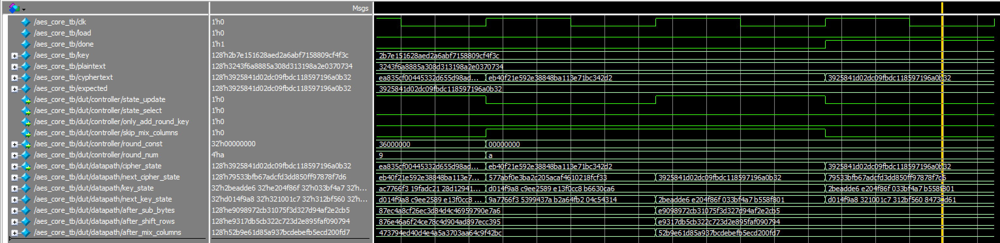

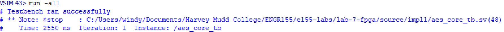

As shown by the waveforms above, the ciphertext matches the expected ciphertext after the encryption has completed. I also included additional waveforms showing that the ciphertext state matches the expected state after rounds 5 and 8:

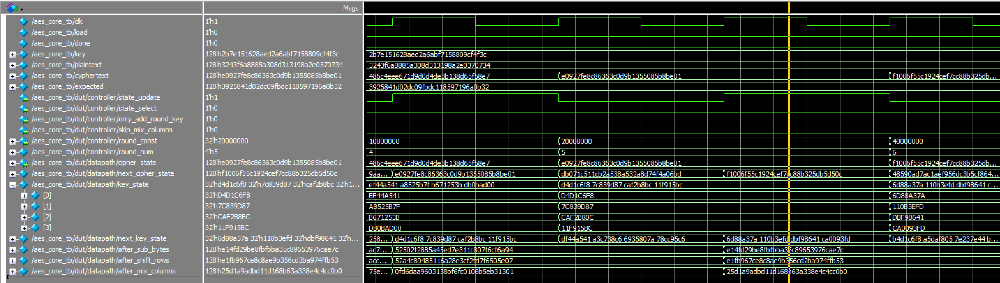

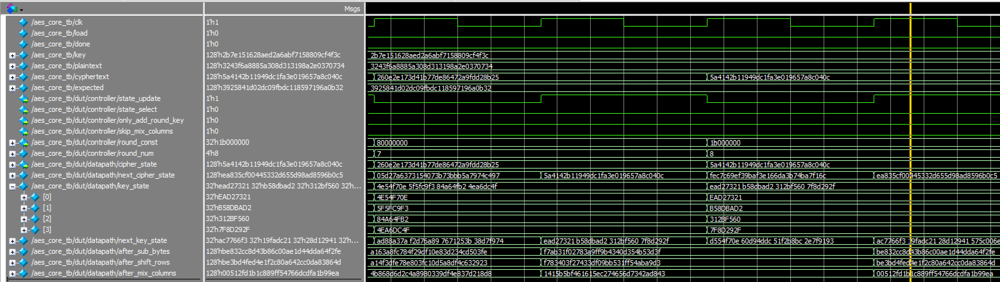

### AES SPI

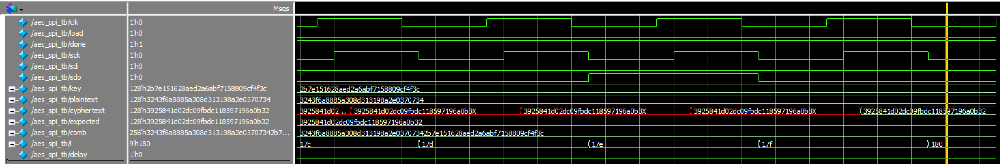

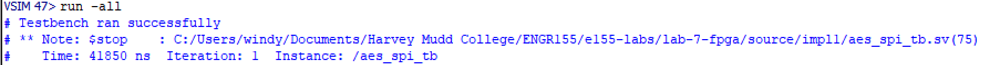

The module also passes the testbench when SPI functionality is added, showing that data can be shifted into and out of the FPGA properly.

The following report shows that the design synthesizes and fits onto the FPGA:

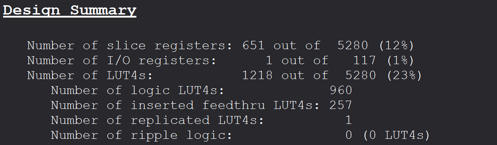


## Block Diagram

The `aes-core` module uses a controller/datapath design pattern to split up the logic for computing the encryption. The controller keeps track of which round of encryption is being performed and instructs the datapath when to update its state. The datapath implements all the modules that actually perform the cipher in hardware.

The `aes-controller` module outputs the following control signals:

- `state_update`: Instructs the datapath to update its state (for the ciphertext and round key) on the next clock cycle. This is required because any operations that perform an sbox lookup have to access a synchronous RAM block, which adds a cycle of latency to each round.

- `state_select`: Tells the datapath where to load its next state from. Before the encryption is performed, we need to instruct the datapath to load its initial state from the provided plaintext and key. For every other round, the datapath loads its state from the output of the previous round.
  - If `0`, the ciphertext and round key load their next states from the outputs of the previous round
  - If `1`, the ciphertext loads its next state from the plaintext input and the round key loads its next state from the key input

- `round_const`: The `key_expansion` process of the cipher uses some constant that changes every round to update the next round key value. Since only the controller has access to the round number that the cipher is on, it has to tell the datapath which constant to use when performing key expansion.

- `only_add_round_key`: As the name suggests, if this signal is true, it instructs the datapath to skip all other steps in the round except for adding the round key. This operation is performed before round 1 of the cipher begins.

- `skip_mix_columns`: As the name suggests, if this signal is true, it instructs the datapath to skip the `mix_columns` procedure, which only happens during round 10.

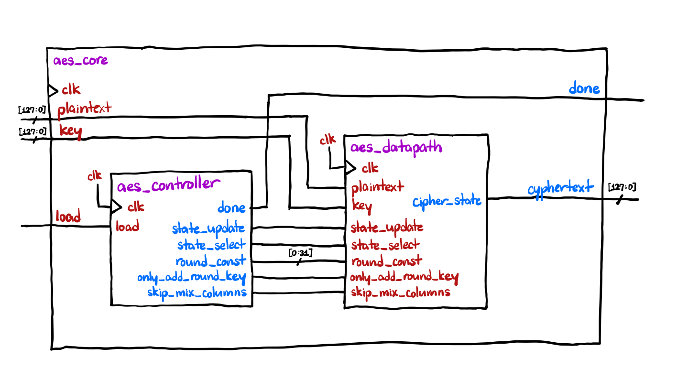

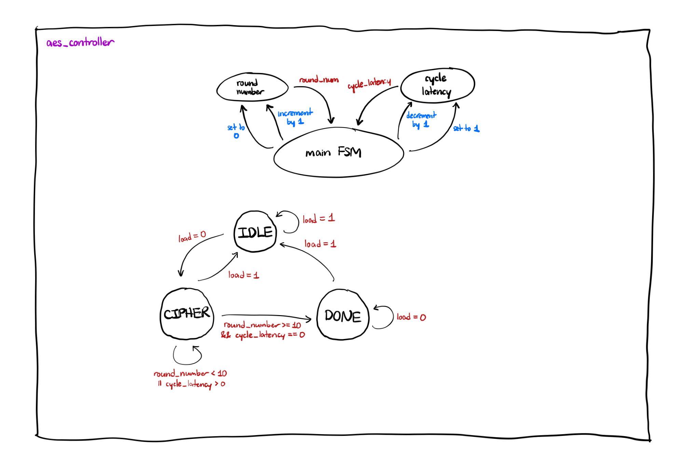

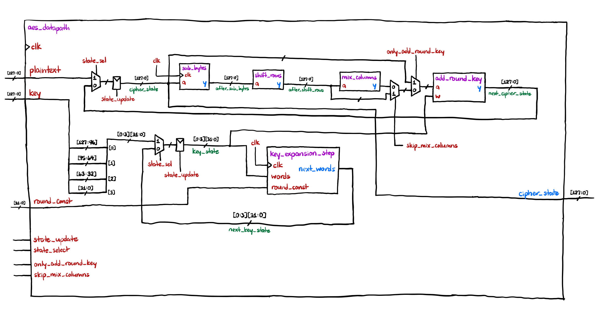

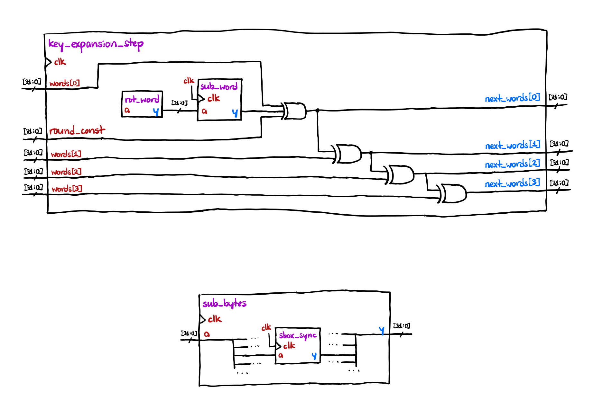


## Results and Conclusion

The design works in both hardware and software, correctly computing the ciphertext and sending it over to the MCU.

I spent a total of **20 hours** on this lab.


## AI Prototype

Prompt 1:

> Write SystemVerilog HDL to implement the KeyExpansion logic described in the FIPS-197 uploaded document. The module should be purely combinational, using the previous key and current round number to calculate the next key. Assume other required modules (SubWord and RotWord) are already implemented.

The AI generated code:

```sv
module KeyExpansion (
    input  logic [127:0] prev_key,
    input  logic [3:0]   round,
    output logic [127:0] next_key
);

    // Previous round key words
    logic [31:0] w0, w1, w2, w3;

    // Next round key words
    logic [31:0] n0, n1, n2, n3;

    // Intermediate transformations
    logic [31:0] rotated_word;
    logic [31:0] substituted_word;
    logic [31:0] rcon;
    logic [31:0] temp;

    // Split previous key into four 32-bit words
    assign {w0, w1, w2, w3} = prev_key;

    // Rotate the final word
    RotWord rot_word_inst (
        .in_word  (w3),
        .out_word (rotated_word)
    );

    // Apply the AES S-box to each byte
    SubWord sub_word_inst (
        .in_word  (rotated_word),
        .out_word (substituted_word)
    );

    // Round constants from FIPS-197, Table 5
    always_comb begin
        case (round)
            4'd1:    rcon = 32'h01000000;
            4'd2:    rcon = 32'h02000000;
            4'd3:    rcon = 32'h04000000;
            4'd4:    rcon = 32'h08000000;
            4'd5:    rcon = 32'h10000000;
            4'd6:    rcon = 32'h20000000;
            4'd7:    rcon = 32'h40000000;
            4'd8:    rcon = 32'h80000000;
            4'd9:    rcon = 32'h1B000000;
            4'd10:   rcon = 32'h36000000;
            default: rcon = 32'h00000000;
        endcase
    end

    // Apply the key schedule core
    assign temp = substituted_word ^ rcon;

    // Generate the next four words
    assign n0 = w0 ^ temp;
    assign n1 = w1 ^ n0;
    assign n2 = w2 ^ n1;
    assign n3 = w3 ^ n2;

    // Combine words into the next round key
    assign next_key = {n0, n1, n2, n3};

endmodule
```

It is nearly identical to the module I implemented in SystemVerilog. The only difference is that the round constant itself is passed into the module, instead of the round number.

Prompt 2:

> Write SystemVerilog HDL to implement the following logic:
>
> Assume module1 and module2 are existing modules that can be instantiated. (+) refers to XOR. Unwrap the loop in the provided pseudo code so it uses the previous iterations output to generate the new iteration.
>
> Do not use any existing knowledge of the AES specifications in your answer.

The AI generated code:

```sv

module KeyExpansion #(
    parameter int Nk = 4,
    parameter int Nr = 10,
    localparam int Nw = 4 * (Nr + 1)
) (
    input  logic [7:0]  key [0:4*Nk-1],
    input  logic [31:0] Rcon [0:Nw-1],
    output logic [31:0] w [0:Nw-1]
);

    // Initialize the first Nk words from the input key.
    for (genvar i = 0; i < Nk; i++) begin : gen_initial
        assign w[i] = {
            key[4*i],
            key[4*i+1],
            key[4*i+2],
            key[4*i+3]
        };
    end

    // Generate each subsequent word combinationally.
    for (genvar i = Nk; i < Nw; i++) begin : gen_expansion

        logic [31:0] temp;

        if (i % Nk == 0) begin : gen_round

            logic [31:0] rotated;
            logic [31:0] substituted;

            module2 u_module2 (
                .in_word  (w[i-1]),
                .out_word (rotated)
            );

            module1 u_module1 (
                .in_word  (rotated),
                .out_word (substituted)
            );

            assign temp = substituted ^ Rcon[i/Nk];

        end else if (Nk > 6 && i % Nk == 4) begin : gen_extra

            module1 u_module1 (
                .in_word  (w[i-1]),
                .out_word (temp)
            );

        end else begin : gen_default

            assign temp = w[i-1];

        end

        assign w[i] = w[i-Nk] ^ temp;

    end

endmodule
```

Interestingly, I actually wrote a version of the key expansion module that computed all the round keys in one go, but it took 10 clock cycles to finish and didn't fit on the FPGA. The approach used by the LLM was similar to mine because we both used generate blocks.

One of the issues with using an LLM to generate code without leaking IP is that you have to abstract away all the sensitive details in the problem you want solved, then when reading the code generated by the LLM, you have to translate all the variables back into meaningful names.